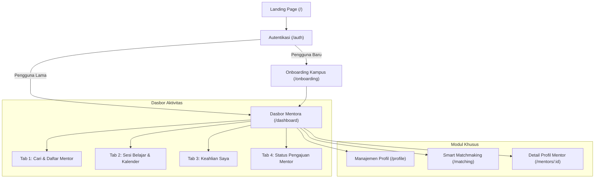

# 🎨 Mentora Design System & Architecture Guide (`DESIGN.md`)

Dokumen ini adalah acuan resmi desain dan antarmuka (UI/UX) Mentora. Panduan ini dirancang agar setiap kontributor, pengembang, dan desainer memiliki pemahaman yang selaras mengenai filosofi visual, sistem token Tailwind, hierarki komponen, alur antarmuka pengguna, serta status implementasi fitur.

---

## 📌 1. Filosofi & Konsep Visual Mentora

Mentora mengusung estetika **"Minimalist Calm & Academic Elegance"** (terinspirasi dari kombinasi Google Material You, Jiro Minimal UI, dan Blocks.so):
- **Tenang & Bersih (Calm Canvas):** Latar belakang tidak menggunakan putih tajam (`#ffffff`), melainkan canvas netral yang lembut (`#f8f9fa`) untuk mengurangi ketegangan mata saat belajar.
- **Kartu Bertekstur Lembut (Soft Surface Cards):** Kontainer kartu menggunakan warna putih solid dengan radius sudut lengkung yang ramah (`rounded-2xl` atau `rounded-3xl`), border hairline halus (`#DADCE0`), dan bayangan awan melayang (*cloud shadow*).
- **Aksen Akademik Terarah:** Warna aksen utama adalah biru akademik (*Google Blue Deep* `#1967d2` & `#1a73e8`), dipadukan dengan chip status hijau pastel (*approved/aktif*) dan aksen kuning emas (*EduPoints/penghargaan*).
- **Tipografi Modern & Humanis:**
  - Font Utama: **Plus Jakarta Sans** (bersih, proporsional, dan sangat mudah dibaca pada berbagai ukuran layar).
  - Font Aksen Kaligrafi: **Caveat** (memberikan sentuhan humanis, coretan catatan mahasiswa, dan keramahan komunitas sebaya).

---

## 🎨 2. Design Tokens & Warna Resmi (Tailwind CSS)

Definisi token warna tersentralisasi pada `tailwind.config.cjs` dan variabel CSS di `src/app/globals.css`:

| Token Name | Hex Code | Utility Class | Penggunaan & Konvensi |
| :--- | :--- | :--- | :--- |
| **Canvas** | `#f8f9fa` | `bg-canvas` | Latar belakang seluruh halaman (*default body*) |
| **Surface** | `#ffffff` | `bg-surface`, `bg-white` | Latar kartu (*card*), modal, navigasi bar, popover |
| **Primary Default** | `#1967d2` | `bg-primary`, `text-primary` | Tombol utama, link aktif, status terpilih |
| **Primary Accent** | `#1a73e8` | `bg-primary-accent`, `text-primary-accent` | Aksen hover, fokus border, highlight interaktif |
| **Primary Soft** | `#e8f0fe` | `bg-primary-soft`, `text-primary` | Background chip/badge aktif, badge notifikasi |
| **Ink (Charcoal)** | `#202124` | `text-ink` | Teks judul utama (*h1*, *h2*, *h3*), label tebal |
| **Ink Secondary** | `#3C4043` | `text-ink-secondary` | Paragraf penjelas, deskripsi, sub-heading |
| **Ink Muted (Slate)** | `#5f6368` | `text-ink-muted` | Teks pendukung kecil, waktu, metadata, ikon non-aktif |
| **Line / Mist** | `#DADCE0` | `border-line` | Border pembatas kartu, input border, garis partisi |
| **EduPoints Gold** | `#E37400` / `#FBBC04` | `bg-warning-tint`, `text-warning` | Badge perolehan poin dan reward sertifikat |
| **Success Emerald** | `#137333` / `#E6F4EA` | `bg-success-soft`, `text-success` | Indikator verifikasi mentor, status sesi terjadwal |
| **Danger Rose** | `#A50E0E` / `#FEF4F3` | `bg-danger-tint`, `text-danger` | Tombol aksi keluar, status penolakan, pesan error |

### Efek Bayangan (*Elevation Shadows*)
- `shadow-2xs`: Bayangan minimal untuk tombol chip, badge, dan filter kecil.
- `shadow-soft-card`: `0 1px 2px rgba(196,198,199,0.33), 0 4px 16px rgba(196,198,199,0.15)` (dipakai pada semua kartu modul & mentor).
- `shadow-cloud`: `0 2px 4px rgba(196,198,199,0.4), 0 6px 20px rgba(196,198,199,0.25)` (dipakai pada dropdown akun, modal dialog, & popover).

---

## 🧩 3. Komponen Desain & Pola UI (Component Architecture)

### A. Navigasi & Header
1. **Global Navbar (`src/components/Navbar.tsx`):**
   - Berposisi sticky di atas dengan latar belakang transparan-blur atau canvas.
   - Sisi Kiri: Logo Mentora SVG + teks merek tebal.
   - Sisi Tengah: Tautan menu utama (`Dashboard`, `Cari Partner`, `Mentor`, `Pesan`).
   - Sisi Kanan: Menu akun pengguna terpadu (Avatar + Nama + Dropdown link langsung ke **Profil Saya** dan **Keluar**).
2. **Dashboard Sub-Header Dock (`src/app/dashboard/DashboardNavigation.tsx`):**
   - Menggunakan dock pill terpadu (`rounded-2xl border border-line bg-canvas p-1`).
   - Item aktif menggunakan latar belakang primer dengan teks kontras putih (`bg-primary text-white shadow-sm`).
   - Sisi kanan menyajikan chip statis informasi akademik (e.g. `🎓 Universitas Telkom`) dan badge `🏅 EduPoints`.

### B. Primitives Kartu & Form (Blocks.so + Kibo UI)
Komponen primitif terletak pada `src/components/dashboard-ui/primitives.tsx`:
- **`Frame` & `FramePanel`:** Kontainer kartu dengan sudut melengkung halus dan padding modular untuk menyusun dashboard modular.
- **`Badge`:** Pill status dengan variasi `neutral`, `success-light`, `warning-light`, dan `outline`.
- **`InlineDot`:** Titik indikator kehadiran atau status keahlian (warna hijau/biru/oranye).
- **`FileDropzone`:** Area unggah dokumen terstandarisasi untuk berkas verifikasi KRS/KTM/Sertifikat mentor.

---

## 🗺️ 4. Peta Halaman & Alur Pengguna (User Journey)

---

## 📱 5. Standar Responsivitas & Aksesibilitas (Responsive & A11y)

1. **Mobile-First & Tablet Breakpoints:**
   - **Ponsel (`< 640px`):**
     - Navigasi utama berpindah ke drawer hamburger dengan target tap min. 44px (`min-h-11`).
     - Sub-header dock tab dasbor dirancang scrollable secara horizontal tanpa bar (`[scrollbar-width:none] [&::-webkit-scrollbar]:hidden`) dengan padding tepi `-mx-3 px-3`.
     - Filter keahlian (chips) pada daftar mentor dan pencocokan partner dapat di-scroll menyamping dengan nyaman.
     - Kalender belajar (*Study Agenda*) merampingkan ukuran sel tanggal menjadi `h-8 text-xs` dan menyusun panel jadwal secara vertikal di bawah kalender.
     - Kartu mentor beralih ke layout 1 kolom dengan padding `p-4` dan tombol aksi yang nyaman ditekan ibu jari.
   - **Tablet (`640px - 1024px`):**
     - Grid kartu beralih ke 2 kolom seimbang (`sm:grid-cols-2`).
     - Agenda belajar dan filter form menyesuaikan padding (`p-6`) dan kontrol filter sejajar.
   - **Desktop (`> 1024px`):**
     - Layout 3 kolom atau split view kalender horizontal (`xl:grid-cols-[1.25fr_1fr]`).
     - Batas kontainer maksimum terpusat di `max-w-7xl mx-auto px-8`.
2. **Keterbacaan & Bahasa (Humanizer Indonesia):**
   - Seluruh teks label, instruksi, dan pesan error menggunakan Bahasa Indonesia yang santun, ramah mahasiswa, tidak kaku, dan bebas terjemahan mesin harfiah.
   - Contoh: Hindari "Submit your credential application", gunakan *"Ajukan keahlian dan dokumen pendukung untuk mulai mengajar"*.

---

## 🚀 6. Checklist Status Implementasi Tim

| Halaman / Fitur | Lokasi Berkas | Status Desain | Keterangan |
| :--- | :--- | :--- | :--- |
| **Landing Page** | `src/app/page.tsx` |  Selesai | Desain hero, value proposition, dan CTA |
| **Autentikasi (Masuk/Daftar)** | `src/app/auth/page.tsx` |  Selesai | Form login/register tabbed + Google Auth |
| **Dasbor Utama (4 Tab)** | `src/app/dashboard/page.tsx` |  Selesai | Daftar mentor, sesi belajar, keahlian, status mentor |
| **Manajemen Profil** | `src/app/profile/page.tsx` |  Selesai | Edit profil, geolokasi GPS domisili |
| **Pengajuan Mentor** | `src/app/mentor/apply/page.tsx` |  Selesai | Upload KRS/KTM, kredensial, form keahlian |
| **Review Admin** | `src/app/admin/page.tsx` |  Selesai | Verifikasi dokumen pengajuan mentor |
| **Smart Matchmaking** | `src/app/matching/page.tsx` |  Selesai | Rekomendasi teman belajar berbasis keahlian & lokasi |

---

## 💡 7. Aturan Kontribusi untuk Rekan Tim

1. **Gunakan Utility Tailwind yang Sudah Ada:** Hindari menambahkan warna kustom *arbitrary value* (seperti `bg-[#123456]`). Selalu gunakan token tema: `bg-canvas`, `bg-surface`, `bg-primary`, `border-line`, `text-ink`, dsb.
2. **Jaga Konsistensi Radius Sudut:** Gunakan `rounded-xl` untuk elemen tombol/input, `rounded-2xl` untuk kartu modul, dan `rounded-full` untuk badge/chip indikator.
3. **Verifikasi Build Sebelum Push:** Selalu jalankan `npx tsc --noEmit` untuk memastikan tipe TypeScript valid sebelum melakukan commit ke repository.
